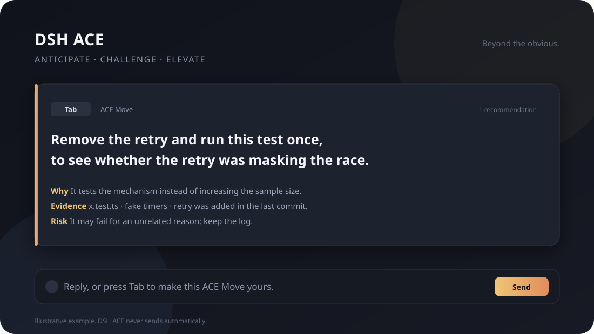

# DSH ACE

**突破已有想法。**

面向 **DeepSeek Harness** 的 next-move 顾问。它读最近几轮对话，找一条比你顺手会打的下一句更有价值的建议，只显示**一张卡**。按 `Tab` 填入草稿，是否发送由你决定。

[](LICENSE)
[](https://github.com/Ghoscro/dsh-ace/actions/workflows/test.yml)

[English](README.md)



> 这是 ACE Move 的示例：它说明这条比“顺手继续”多得到什么，而不是把自动补全写长。

## 它做什么

大多数下一句工具优化的是**你大概会打什么**。ACE 优化的是**下一句值不值得发**。

- 内部生成 3–5 个不同方向：推进、用现成工具、重新框定、验证、澄清、收范围、收尾。
- 按 `value`、`novelty`、`worth_extra_step` 和动作类型打分。
- 只显示**一条**，带 `why`、`evidence`、`risk`。
- 没有一条比顺手“继续”更好时，**不出卡**。安静是功能，不是故障。
- `Tab` 只填入草稿；ACE 不会替你发送。

## 演示

上图是目标闭环：

1. 助手问“要不要跑全量？”
2. 最顺手的下一句是“跑吧”。
3. ACE 提出：“把重试去掉，只跑这一次，确认重试是不是掩盖了竞态。”
4. 卡片说明为什么这条信息量更大、用了什么证据、风险是什么。
5. `Tab` 填入，你决定发不发。

第一版 beta 后会用真实录屏替换示意图。当前图片是渲染示例，不是 benchmark 结果。

## 快速开始

**状态：** 本地包/源码安装。npm 上 `dsh-ace` 已被无关项目占用；使用 scope 包 `@ghoscro/dsh-ace`。npm 发布等待凭据。

已验证宿主：**DSH 0.2.1-rc.2**。其他版本可能可用，但尚未验证。

1. 把包放到 `<profile>/sakura/packages/dsh-ace`。
2. 在 profile 的 `package.json` 依赖中加入：

   ```json
   "@ghoscro/dsh-ace": "file:./sakura/packages/dsh-ace"
   ```

3. 把 `"@ghoscro/dsh-ace"` 加入 `dsh.profile.bundles`。
4. 在 profile 里 materialize（`pnpm install` 或 DSH 插件页），重启 DSH。
5. 打开对话，composer 工具行出现 **✦ 深度预测**。点击它，或等下一轮完成（如果开了自动 ACE）。
6. 在卡片上按 `Tab` 填入草稿。

从 `dsh-composer-predict` 迁移，先读 [MIGRATION.md](MIGRATION.md)。不要同时加载两个包。

## 三个案例

这些是示例，不是受控 benchmark。它们展示 ACE 想增加的价值。

### 1. 可能被重试掩盖的测试

- **顺手：** “跑全量。”
- **ACE Move：** “把重试去掉，只跑这个用例一次；如果失败，说明重试掩盖了竞态。”
- **多得到什么：** 验证机制，而不是增加样本量。
- **风险：** 可能因为无关原因失败。

### 2. 更省事的实现路径

- **顺手：** “写个小脚本批量处理。”
- **ACE Move：** “直接用现有 CLI 的 `--json` 输出接管道；不新增要维护的脚本。”
- **多得到什么：** 更小的维护面，更短到结果的路径。
- **风险：** CLI 可能没有你要的字段。

### 3. 做偏了的任务

- **顺手：** “继续打磨当前卡片。”
- **ACE Move：** “卡点不在卡片，新 profile 上安装仍然失败。先修安装，再做视觉。”
- **多得到什么：** 指出真正的约束，改变工作顺序。
- **风险：** 安装失败可能只在特定环境出现。

## 工作方式

1. 浏览器把最近对话和 session `cwd` 发给宿主路由。
2. 宿主构建只读、截断的 `git` 证据包（status、diff stat、last commit、bounded diff）。
3. 本地生成确定性 situation（最后用户目标、助手 offer、显式约束），不再单独调用 situation 模型。
4. **一次**模型调用返回 3–5 行 JSONL 候选，加一行选择。
5. 宿主按分数选**一条**。固定槽位排序已移除；`verify`/`constrain` 有惩罚，“再检查一下”不能默认胜出。
6. 最高分低于阈值时，不出卡。
7. `Tab` 填入草稿；卡片里的 `why`/`evidence`/`risk` 不随消息发送。

解析器按花括号扫描 JSON 对象，遇到截断/坏行会跳过，但保留前面有效候选。一行坏了不会拖垮整次响应。

## 设置与成本

- **自动 ACE：** 每轮完成后生成一条；可在「深度预测设置」里关闭。
- **暂停：** 停止自动建议；`✦ 深度预测` 仍可按需使用。
- **模型：** 使用当前 DSH agent default，或插件配置的 route。
- **隐私：** 最近对话和本地证据包会发给选中的模型；不写入会话，不跨会话学习。
- **成本：** 每次 ACE 建议一次模型调用。发布前会补 fast/expert × 短/长上下文的真实 token 表；自动 ACE 是较贵的模式，只想按需使用时可以暂停。

## 开发

```bash
npm test
```

在运行中的 DSH 上测真实 token 用量。macOS / Linux：

```bash
COMPOSER_PREDICT_BASE=http://127.0.0.1:13770 node scripts/token-tiers.mjs
```

Windows（PowerShell）：

```powershell
$env:COMPOSER_PREDICT_BASE='http://127.0.0.1:13770'
node scripts/token-tiers.mjs
```

覆盖 prompt/parser、JSONL 坏行保留、选卡打分、不出卡、路由响应和单卡交互。兼容范围写在 `package.json.dsh.compatibility`；未列出的版本按未验证处理。

## 卸载

从 profile 移除 bundle 和依赖，重启 DSH，再删除包目录。旧 `composer-predict` 路由和设置键保留用于迁移；卸载新包不会删除本地设置。

## 作者

**米哈游关卡灯光艺术家 Micker Wenyu.Yang的DSH插件作品。**

## 许可证

[MIT](LICENSE)。贡献使用 DCO sign-off，不引入 CLA。见 [CONTRIBUTING.md](CONTRIBUTING.md) 和 [SECURITY.md](SECURITY.md)。
